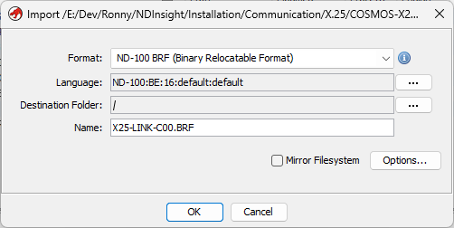
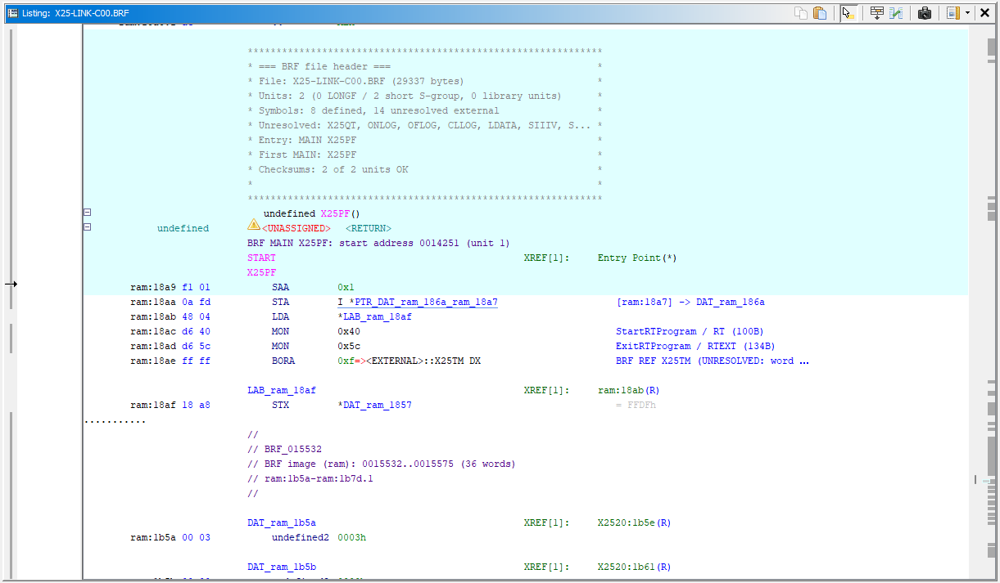
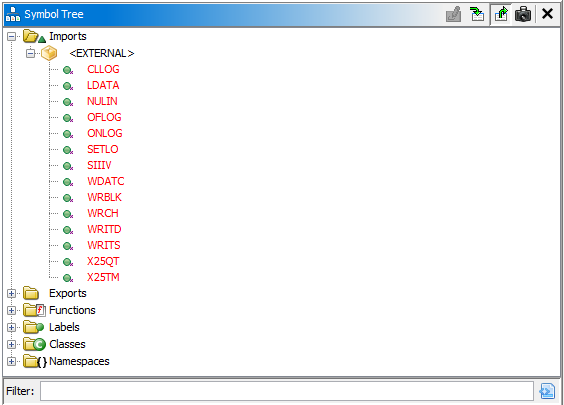
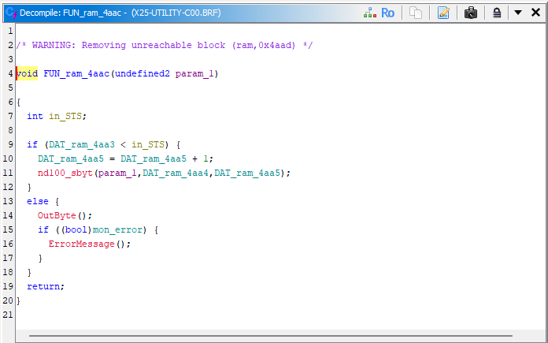
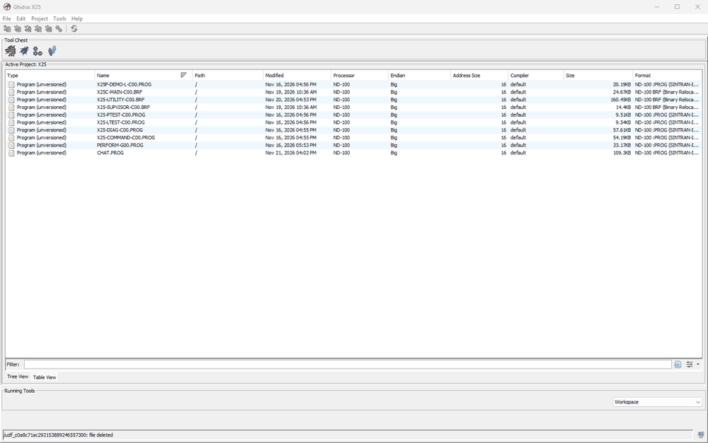

# Screenshots

What the plugin looks like in Ghidra. Each picture below is taken by hand in the Ghidra
window; a slot that still says *not captured yet* is on the list, not missing by mistake.

## How the pictures are taken

- Ghidra 12.2 with release v0.4.1 of the plugin installed, the default Ghidra theme.
- Saved with Win+Shift+S. A dialog may be taken in Window mode at its own size; a panel is
  cropped to the panel.
- PNG, saved under `src/assets/screenshots/` with the file name given below. The site picks a
  picture up as soon as the file is committed; nothing else needs changing.
- Programs from the NDInsight repository (it holds the BRF files); PROG and BPUN files from
  your own Ghidra project.

## The pictures

### Importing a BRF file

File → Import File on `X25-LINK-C00.BRF`. The format box already shows
**ND-100 BRF (Binary Relocatable Format)**: the plugin recognised the file by itself.

### A BRF program after import

`X25-LINK-C00.BRF` opened in the listing at its start address `X25PF`. The box above it is the
summary the loader writes for the file: its units, how many symbols it defines and how many it
uses from outside (X25QT, ONLOG, ...), the entry point, and whether the checksums are right.
On the right, monitor calls are named (`MON 0x40` is StartRTProgram) and a reference to an
outside symbol is marked (`BRF REF X25TM`).

### Outside references become imports

The Symbol Tree of `X25-LINK-C00.BRF` with **Imports** opened. For each symbol the file uses
but no unit in it defines, the loader makes an outside (external) symbol, and the word that
uses it gets a reference to that symbol. This file has 14: X25QT, ONLOG, OFLOG, CLLOG, LDATA,
SIIIV, SETLO, NULIN, WRITS, WDATC, WRITD, WRBLK, WRCH, X25TM.

### A library bigger than 64K words

Window → Memory Map for `X25-UTILITY-C00.BRF`: the extra block `BRF_PAGE2`. The plugin loads
every unit of a library, so all code can be read; the real SINTRAN loader only loads a library
unit when something uses one of its symbols. This library has 761 (decimal) units, 0x1321A
words in all, more than the 64K words one address space holds. When the next unit would run
past address 0177777 (octal), it and the units after it go into a new space `BRF_PAGE2` with
the same addresses but separate memory (a Ghidra overlay). A unit is never split.

### The ND-100 analyzers

Analysis → Auto Analyze on any ND-100 program: the seven ND-100 analyzers, all ticked by
default: ND-100 Call Return Tracker, ND-100 Dispatch Table Detector, ND-100 I/O Device
Registers, ND-100 I/O Instruction Annotator, ND-100 Indirect Reference Resolver, ND-100 MON
Call Annotator, ND-100 Stack Frame Annotator.

### Monitor calls in the decompiler

`X25-UTILITY-C00.BRF` at `0x4aac`, a short routine that writes one byte, in the decompiler
window. The language gives each monitor call its own named operation, so `MON 2` (octal) shows
as `OutByte()` and `MON 65` (octal) as `ErrorMessage()`. For a call with an error return (the
word right after MON), the language tests `mon_error`: a flag that stands for "the call took
its error return", set by SINTRAN, never by the program. The decompiler shows that error path
as `if ((bool)mon_error) { ErrorMessage(); }`.

### PLANC routines named automatically

`CHAT.PROG` from `0x442c`: the end of one PLANC routine and the start of the next. When
analysis ends, the ND-100 Call Return Tracker names the PLANC runtime routines (5ENTR at
`0xd096`, 5INIT, 5LEAV, 5ERET) by what their code does, not by address. In the picture:

- `0x442e` calls 5LEAV. The tracker knows it does not come back here ("returns for the caller
  through its frame, not here"), so the words after it are data: pointers to 5ENTR and 5LEAV.
- `0x4436` calls 5ENTR at the start of the next routine. The tracker knows it comes back one
  word later ("returns to call+2"), and the word between, `0x4437`, is marked as the stack
  space the routine needs, with a comment starting `[nd100-planc]`.
- The comments `[ram:4434] -> 5LEAV` and `[ram:4445] -> 5ENTR` name the routine each
  indirect call reaches.

A name or comment a person wrote is never replaced.

![The listing of CHAT.PROG from 0x442c: a call to 5LEAV that does not return, then a call to 5ENTR followed by its stack space word marked [nd100-planc].](../assets/screenshots/planc-marks.png)

### A jump table followed

`FLOPPY-FU-1986F.BPUN` from `0x09ae`: `SAA 7` and `RAND ST` mask an index down to the
range 0 to 7 (the tracker works out the possible values from the code), and `RADD SA DP` at `0x09b2` adds it to P, the program counter, so the program
jumps into the table of eight `JMP` instructions that follows (0x09b3 to 0x09ba). Ghidra cannot
follow such a jump by itself. The ND-100 Call Return Tracker runs the jump once for each value
the index register can hold (at most 4 unknown bits), adds a computed-jump reference to each
target, and disassembles the targets. This program has a second such table at `0x09fb`.

### The short recording for the README

`src/assets/screenshots/demo.gif`: seven window pictures in a row, about 16 seconds: the project
window, picking `X25-LINK-C00.BRF`, the import dialog with **ND-100 BRF** chosen by itself, the
import summary, the "Analyze?" question, the analysis options with the ND-100 analyzers, and the
listing at `X25PF`. Each window was captured on its own (the Ghidra windows set to 1600 x 1000
pixels), a dialog is drawn over its window with the window darkened, and the frames are scaled
to 1000 pixels wide.

