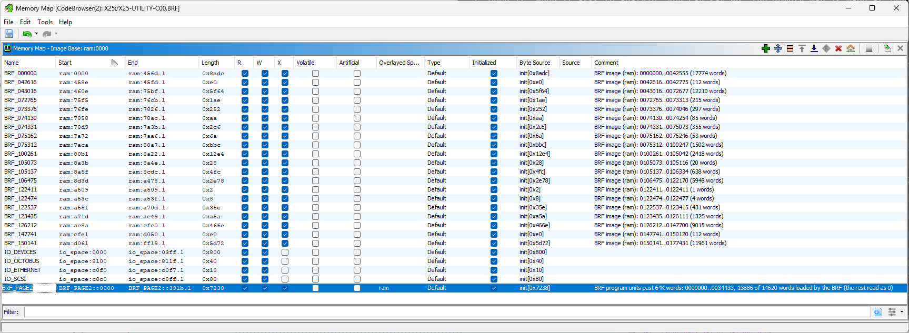
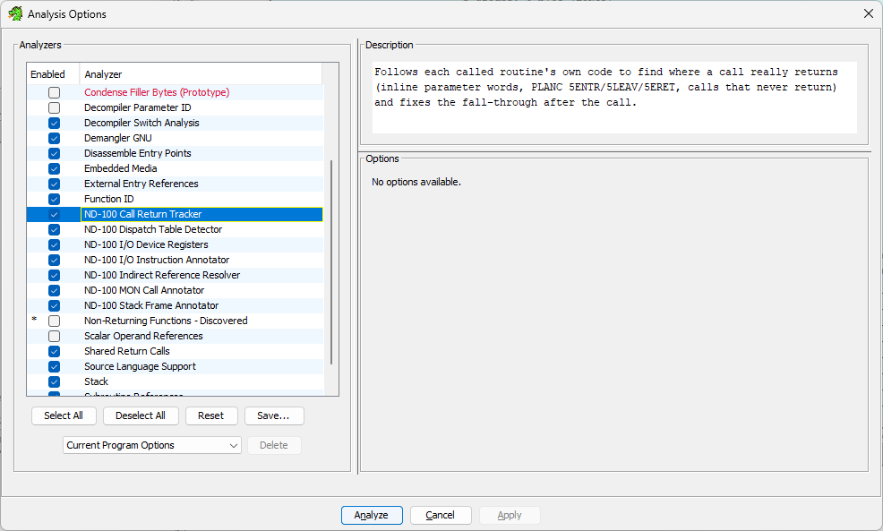
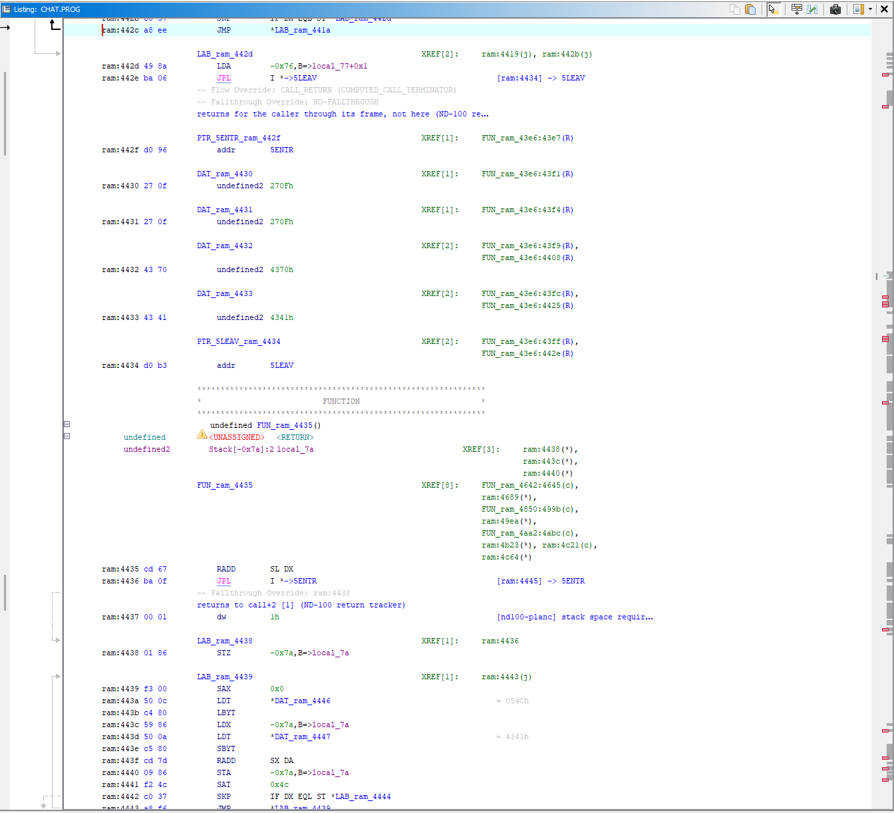
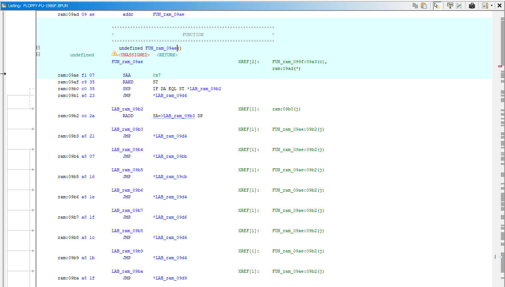

# Screenshots

What the plugin looks like in Ghidra. Each picture below is taken by hand in the Ghidra
window; a slot that still says *not captured yet* is on the list, not missing by mistake.

## How the pictures are taken

- Ghidra 12.2 with this plugin installed (the latest release), the default Ghidra theme.
- The Ghidra window about 1600 x 1000 pixels; crop to the part the caption names.
- PNG, saved under `src/assets/screenshots/` with the file name given below. The site picks a
  picture up as soon as the file is committed; nothing else needs changing.
- Programs from the NDInsight repository (it holds the BRF files); PROG and BPUN files from
  your own Ghidra project.

## The pictures

### Importing a BRF file

File → Import File on `X25-LINK-C00.BRF`. The format box already shows
**ND-100 BRF (Binary Relocatable Format)**: the plugin recognised the file by itself.

### A BRF program after import

`X25-LINK-C00.BRF` opened in the listing at its start address `X25PF`: the plate comment the
loader writes for the unit (file offset, program base, checksum) and the comments on the
reference words.

### Outside references become imports

The Symbol Tree of `X25-LINK-C00.BRF` with **Imports** opened: the symbols the file uses but
does not define (X25QT, ONLOG, OFLOG, ...).

### A library bigger than 64K words

Window → Memory Map for `X25-UTILITY-C00.BRF`: the units that do not fit in 64K words are in
the extra block `BRF_PAGE2`.

### The ND-100 analyzers

Analysis → Auto Analyze on any ND-100 program: the list with the ND-100 analyzers ticked
(Call Return Tracker, Dispatch Table Detector, MON Call Annotator, ...).

### Monitor calls in the decompiler

A routine of a SINTRAN program that makes a monitor call, in the decompiler window: the call
is shown by its name, and its error return as `if (mon_error)`.

### PLANC routines named automatically

`CHAT.PROG` at `0xd096`: the PLANC runtime routine the plugin named `5ENTR`, and the
`[nd100-planc]` comments on the words after a call to it.

### A jump table followed

`FLOPPY-FU-1986F.BPUN` at `0x09b2`: an 8-entry jump through a register, with the eight targets
found and disassembled.

### The short recording for the README

5 to 15 seconds, under 10 MB, as `src/assets/screenshots/demo.gif`: importing a BRF or PROG
file and the listing appearing with names and comments.

